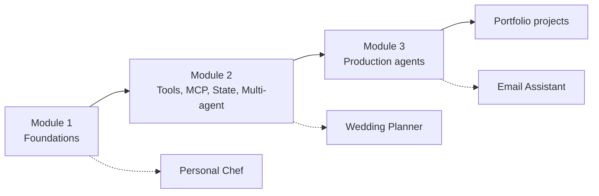

# LangChain Academy: Introduction to LangChain (Python)

My hands-on practice repo for the official LangChain Academy course
[Introduction to LangChain - Python](https://github.com/langchain-ai/lca-lc-foundations).
Every notebook is typed and run by me, then compared with the course code.

**Goal:** build the skills for AI Engineer / Agentic AI Engineer roles, and turn the
three course projects into standalone portfolio repos.

## What I'm learning



## Progress

### Module 1: Foundations
- [x] 1.1 Foundational models (initialising and invoking a model)
- [x] 1.2 Prompting (basic, few-shot, structured prompts, structured output)
- [x] 1.3 Tools (tool definitions)
- [x] 1.4 Web search tool (Tavily)
- [x] 1.5 Memory (checkpointer and `thread_id`)
- [x] 1.6 Multimodal messages
- [x] 1.7 Project: Personal Chef agent (`personal_chef.py`)

### Module 2: Tools, MCP, state and multi-agent
- [x] 2.1 MCP: client, servers, travel agent
- [x] 2.2 Runtime context and state
- [x] 2.3 Multi-agent
- [x] Bonus: RAG over a PDF, SQL agent
- [ ] 2.4 Project: Wedding Planner

### Module 3: Production agents
- [x] 3.2 Managing messages (summarization and trimming)
- [x] 3.3 Human-in-the-loop (approve, reject, edit)
- [x] 3.4 Dynamic models
- [ ] 3.5 Project: Email Assistant

## Repo layout

```
langchain-academy/
├── notebooks/
│   ├── module-1/    # foundations + Personal Chef
│   ├── module-2/    # MCP, state, runtime context, multi-agent, RAG, SQL
│   └── module-3/    # message management, HITL, dynamic models
├── pyproject.toml   # dependencies (managed with uv)
├── .env             # API keys (not committed)
└── README.md
```

## Key concepts covered

| Concept | Where |
|---|---|
| `init_chat_model`, `create_agent` | Module 1 |
| `@tool`, web search, structured output | Module 1 |
| Checkpointer (`InMemorySaver`) and `thread_id` | 1.5 |
| MCP servers and `MultiServerMCPClient` | 2.1 |
| State (`AgentState`) vs runtime context (`ToolRuntime`) | 2.2 |
| Multi-agent, RAG, SQL | 2.3, bonus |
| `SummarizationMiddleware`, `@before_agent`, `RemoveMessage` | 3.2 |
| `HumanInTheLoopMiddleware`, `Command(resume=...)` | 3.3 |
| Dynamic model selection | 3.4 |

## Setup

```bash
git clone https://github.com/sivahere4cloud/langchain-academy.git
cd langchain-academy
uv sync
```

Create a `.env` file in the repo root:

```
OPENAI_API_KEY=...
TAVILY_API_KEY=...
# optional, only for the notebooks that use them
ANTHROPIC_API_KEY=...
GOOGLE_API_KEY=...
```

Open any notebook in VS Code or Jupyter and select the `.venv` kernel.
Restart the kernel after installing new packages.

## Windows note

The MCP notebooks need `pywin32` (already in `pyproject.toml`) and the asyncio
fix cell at the top of the notebook.

## Workflow

One branch per module, one pull request per module into `main`,
merged with a merge commit so every commit stays visible.

## Next

Standalone portfolio repos, each with a README flowchart:
`personal-chef-agent`, `wedding-planner-multi-agent`, `email-assistant-hitl-agent`.
